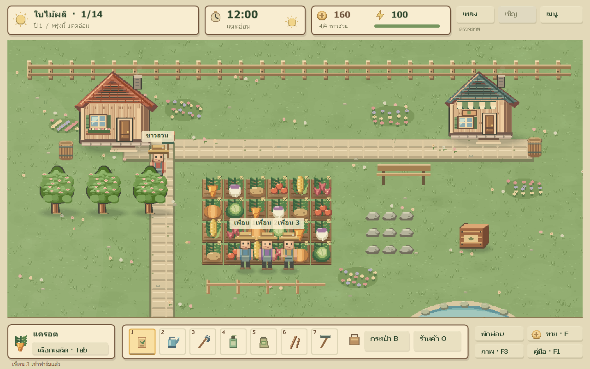

# game — สวนเพลง: Seasons Together

เกมปลูกผัก Windows แบบ native เล่นร่วมกันผ่านอินเทอร์เน็ตได้สูงสุด 4 คน มีฤดูกาล สภาพอากาศ โรคพืช ช่วงเก็บเกี่ยว และแอนิเมชันการทำฟาร์ม

## ดาวน์โหลดและเล่น

ดาวน์โหลด `SuanPleng-Windows.zip` จาก [Releases](https://github.com/Numcha1/game/releases) แตกไฟล์ แล้วเปิด `SuanPleng.exe` บน Windows x64 ไม่ต้องติดตั้ง .NET

เจ้าของฟาร์มเลือกสร้างห้องออนไลน์แล้วส่งลิงก์เชิญทั้งเส้นให้เพื่อน เพื่อนเปิดเกมและเลือกเข้าห้อง เจ้าของห้องต้องเปิดเกมไว้ระหว่างเล่น ห้องใช้ Cloudflare Quick Tunnel และลิงก์เปลี่ยนเมื่อเปิดใหม่

## รุ่น 0.3 — Cozy Graphics Update

ภาพ pixel art ที่สร้างขึ้นสำหรับเกมนี้โดยเฉพาะ: พื้นหญ้าและดินมี texture อาคารและต้นไม้มีรายละเอียด แสงตามเวลา เงานุ่ม หน้าต่างเรืองแสงในกลางคืน ฝนและบ่อน้ำมี ripple ตัวละครเดินและใช้เครื่องมือแบบมีแอนิเมชัน รวมถึงเอฟเฟกต์ปลูก รดน้ำ เก็บเกี่ยว และเหรียญขายผลผลิต

UI ภาษาไทยเป็นแถบสถานะและ Hotbar พร้อมหน้าต่างเมล็ด กระเป๋า ร้านค้า และการตั้งค่าภาพ Low / Medium / High รองรับขนาดจอและปรับระยะกล้องได้ ระบบฟาร์ม เครือข่าย และเซฟเดิมยังใช้กฎและรูปแบบเดิม



## ปุ่มควบคุม

- WASD / ลูกศร: เดิน · คลิกแปลงใกล้ตัว: ใช้เครื่องมือ · 1–7: เปลี่ยนเครื่องมือ
- Tab: เมล็ด · B: กระเป๋า · O: ร้านค้า · E: ขายใกล้ลัง · Space: นอนใกล้บ้าน
- F1: คู่มือ · F2: ลดแอนิเมชัน · F3: ตั้งค่าภาพ · M: เสียง · + / −: ระยะกล้อง

เพลง YouTube เปิดผ่านเบราว์เซอร์แยกจากตัวเกม รายละเอียดอยู่ใน [คู่มือ](native/README.md)

## สร้างเกมจากซอร์ส

ติดตั้ง .NET SDK 8 บน Windows แล้วเปิด PowerShell ในโฟลเดอร์โปรเจกต์:

```powershell
./native/build.ps1
```

สคริปต์ดาวน์โหลด cloudflared รุ่นที่กำหนดจาก Cloudflare พร้อมตรวจ SHA-256 แล้วสร้างเกมแบบ self-contained ไปที่ `native/release/SuanPleng.exe` งานภาพสร้างจากซอร์สของเกมเอง ไม่มีภาพอ้างอิงหรือ asset ที่ไม่ได้รับอนุญาตรวมอยู่ในเกม

ดู [รายงานการแก้ไขและผลทดสอบ](native/PERFORMANCE.md) สำหรับ frame time, FPS, memory และข้อจำกัด รวมถึงวิธีรัน regression/graphics/network checks

- `native/`: ซอร์สเกม Windows C# / WinForms และหลักฐานทดสอบ
- `dist/`: เกมเว็บต้นแบบเดิม
- `CLOUDFlARED-LICENSE.txt`: ใบอนุญาต Apache-2.0 ของตัวเชื่อมต่อที่รวมใน EXE

ห้องออนไลน์ยังเป็นบริการชั่วคราว ยังไม่มีเซิร์ฟเวอร์ถาวร ผลประสิทธิภาพเป็นการวัดบนเครื่องทดสอบ ไม่รับรอง 60 FPS เท่ากันทุกเครื่อง
