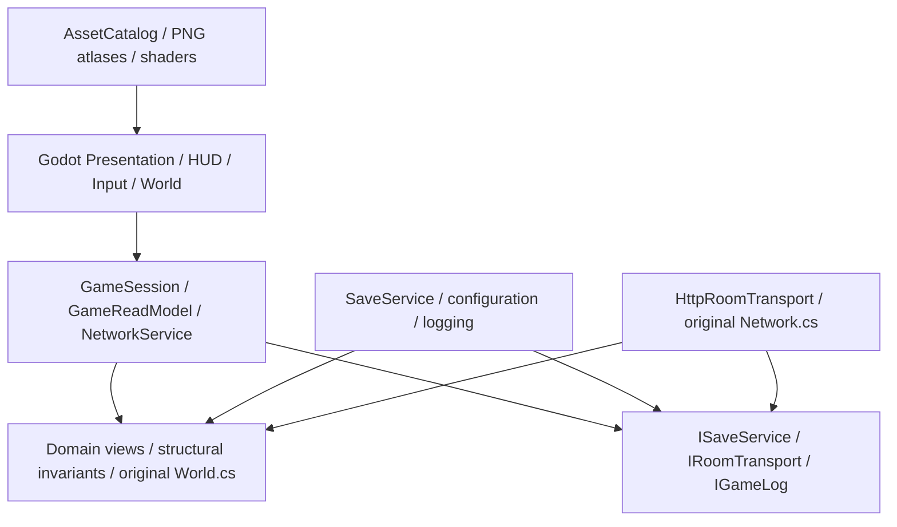

# Technical Design Document

## Foundation

Base `godot/vertical-slice` -> `feature/production-core`, merging the tested modular foundation. Native is retained. Godot 4.7.2 .NET, C# net8.0, Compatibility renderer, 800x450 viewport, nearest filtering and integer scale.

| Owner | Responsibility | Exclusions |
|---|---|---|
| World.cs | crop/time/weather/energy/economy/ownership rules | engine/UI/audio |
| GameSession | owner-thread commands, events, save snapshots | rendering/network prediction |
| GameReadModel | immutable views, journal snapshots, native forecast | state mutation |
| SaveService | bounded async writer, schema validation, import undo/recovery | farm rules |
| NetworkService + HttpRoomTransport | ordered requests, UUID retries, auth boundary, validated snapshots | local crop simulation |
| FarmScene | compose services, scene lifetime, routing | duplicate business rules |
| FarmHud/Input | read model, tool selection, inspect/confirm/menu | direct disk writes |
| FarmWorldPresenter/AssetCatalog | cached original resources, tile/sprite presentation | game state ownership |
| Diagnostics/Tests | isolated profiles, real loop/performance/lifecycle checks | modifying player saves |

## Save Version 1

Farm JSON schema stays v1. Legacy BOM-marked UTF-8, UTF-16 LE/BE and UTF-32 farm/identity files remain readable, matching the original StreamReader behavior; ordinary writes stay UTF-8. Runtime profile `%LOCALAPPDATA%/SuanPleng/godot-slice` is separate from Native. Identity is a secret GUID, snapshots expose hashed IDs. Missing, corrupt, or unrelated identity for an inhabited farm fails closed; never overwrite with a new owner. Startup catches `InvalidDataException` explicitly (it is not an `IOException`).

Ordinary saves capture immutable UTF-8 bytes on the session thread and replace through one bounded worker. Previous file retained as `.bak`. Explicit recovery only offers a validated backup with matching identity; retains damaged bytes as `.corrupt-<GUID>` and does not silently fall back.

Legacy import validates source first, retains paired `before-import` backups, writes a durable `.import-pending` undo record before either live file changes, replaces farm and identity, then removes journal to commit. Startup rolls back pending imports before reading either file. Journal contains only bounded bytes, no file paths. Invalid journal refuses all mutation. Repeat recovery is safe while the journal exists. Tests reconstruct interrupted on-disk boundaries; physical power-loss/filesystem durability is not certified. A lifetime FileShare.None profile lease prevents independent Godot processes and backup recovery from racing a live writer. Constructor failure releases the lease; shutdown waits for import/writer before release. The lock protects cooperating Godot processes; Native retains its separate profile.

## Multiplayer

Exact existing POST `/game` / Bearer / JSON Request+Reply protocol retained. Server authorizes movement, actions, shared funds/time/weather and inventory ownership. Godot online scene, host adapter, remote avatar projection, and Internet QA are pending. Native save remains synchronous under server lock and malformed nullable request fields need hardening before exposing a new Godot host. No claims of full migration.

## Resource lifecycle

AssetCatalog shares textures/regions/frames; HUD shares its installed Thai SystemFont and glyph cache across scene reloads. Presentation loads nothing per-frame. Pooled rain/action effects owned by scenes. Event handlers explicitly detach; scene cancellation cancels diagnostic waits. Config/save operations are asynchronous. UI inspector reacts immediately to plot events; time-only HUD refresh remains throttled. Detailed baseline architecture: `docs/ARCHITECTURE.md`.

## Compatibility

Original `World.cs`, `Network.cs`, root Native executable, art PNGs, scenes and shaders are preserved. New view properties are not serialized into Farm DTO or network protocol. Commands continue delegating to original rules. Generated diagnostic profiles, logs and identity secrets are excluded from Git.

## CI boundary

`.github/workflows/core-regression.yml` builds/runs Core tests on Windows with the pinned SDK and uploads only the test summary (never profile folders/identity secrets). It does not yet build the Godot editor, render scenes, export or certify multiplayer. Action usage follows the official [checkout](https://github.com/actions/checkout), [setup-dotnet](https://github.com/actions/setup-dotnet), and [upload-artifact](https://github.com/actions/upload-artifact) documentation. Remote execution is only VERIFIED after a successful Actions run.
