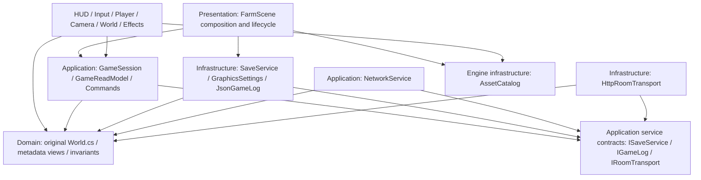

# Modular architecture

Base: `godot/vertical-slice` (`ecf7e327`). Implementation branch: `godot/modular-architecture`. This is a tested modular single-player architecture with a future online seam. It is not a claim that the legacy native host or Godot internet multiplayer migration is complete.

## Dependency direction

The existing Core assembly is retained. Layer boundaries are source/namespace boundaries, checked by automated tests. Splitting every layer into an assembly would add projects without a present benefit. Engine-specific assets remain in the Godot assembly; Core has no Godot, WinForms or graphics references. `World.cs` and the legacy protocol are linked from `native/`, not copied. `LocalFarmSession` and `LegacyRoomAdapter` remain compatibility facades for existing regression consumers; live Godot presentation uses `GameSession`.

The legacy `Farm` aggregate contains synchronous `Load/Save` methods and mutable public properties for native compatibility. New production Godot consumers cannot access it through the application API. Only compatibility facades, infrastructure and explicit diagnostics fixtures use it. This is a documented transition exception, not a second rule implementation. The six domain concerns remain together where daily growth, weather, inventory decay and economy are transactionally coupled; no redundant farming services or empty interfaces were introduced.

## Responsibility matrix

| Concern | Domain authority | Application responsibility | Infrastructure / presentation |
|---|---|---|---|
| Farming | `native/World.cs`: Farm.Action, NextDay, Plot, crop catalog | Validate command shape; delegate rules; expose PlotView | World presenter chooses existing growth sprites; HUD selects tools |
| Inventory | Farmer.Bag, harvest and overnight decay in World | Immutable InventoryItem snapshot; original SalePrice | Bag menu reads snapshots |
| Economy | Farm.Coins, SalePrice, Rescue, greenhouse costs | Commands and change notifications | Existing shop/sell UI; confirmed effects only |
| Player | Farmer; Walkable, Distance, energy/sleep rules | Thread ownership; Move; PlayerView | FarmerController animation, original speed/collision; PixelCameraFollower |
| World | Farm aggregate, season/collision coordinates | Session and read model | FarmWorldPresenter tiles/props/shadows |
| Time & weather | Tick, CheckSleep, Forecast, NextDay | Tick coordination, autosave cadence, useful GameChange flags | Existing lighting/rain/shaders; same quality controls |
| Save | v1 model, structural invariants | ISaveService, checkpoints, failure notification | SaveService single writer/atomic replacement/backup/import rollback |
| Network | Legacy server authoritative rules | NetworkService session/retry/timeout/serialized snapshot publication | HttpRoomTransport exact legacy DTO protocol; native host retained |
| Assets | Crop names from original catalog | None | AssetCatalog validates manifest and caches imported resources/regions/frames |
| Diagnostics | No gameplay changes | Structured codes through IGameLog | Bounded frame monitor, isolated smoke and lifecycle harness |

## Command and state flow

Input maps existing controls to `GameCommand`. The session rejects unknown actions, invalid plot indexes and unknown plant seeds before mutation. Affordability, distance, seasons, disease, harvest windows and owner authority remain entirely in `Farm.Action/Rescue/Tick`. Session state is owned by its creating thread. UUID history is bounded to 512; repeated commands return their message without another state change or animation.

`GameReadModel` exposes detached readonly value views and an immutable inventory snapshot. UI never receives mutable Farm/Farmer/Plot or Bag references. Tick announces minute/day changes; successful commands announce state changes; movement announces position only. HUD ignores position changes and refreshes dirty status at the existing 0.25 second cadence. No global event bus. Scene and HUD unsubscribe explicitly; session disposal clears observers.

## Persistence and schema

Capture/validation/serialization occurs on the owning session thread. A bounded channel retains the newest pending immutable UTF-8 snapshot; a single worker owns disk writes. There is no synchronous file write in Tick or player command handlers. Startup reads and identity creation remain synchronous and outside the game loop. JSON remains Version 1 and is readable by `Farm.Load`. Older v1 files without animation fields still load. Future versions fail closed until an explicit migration is implemented; no speculative schema changes.

The worker writes a unique temporary file in the same directory, flushes it, and uses `File.Replace` with `.bak` for an existing save. Flush/checkpoint failures are observable and retryable; they do not silently replace a valid profile with an empty farm. Corrupt saves are refused with a startup error; retain the original and validate/restore a backup manually. Imports validate first, preserve both previous farm and identity, install both, and rollback when the second replacement fails. Imports wait for prior saves; disposal waits for active import; input/tick are suspended during import; the old scene cannot overwrite the imported farm.

Remaining durability boundary: atomic replacement is per file. A power loss between farm and identity replacements is not a crash-atomic two-file transaction. Keep paired `.before-import-*` backups. A recovery journal is a future hardening step. Tests exercise disk failure and rollback, not abrupt power loss or arbitrary filesystem hardware.

## Network seam

HTTP adapter preserves POST `/game`, bearer header, original JSON names and UUID format. Redirects are disabled, responses are bounded/structurally validated, remote cleartext bearer transport is rejected (loopback HTTP remains supported). NetworkService serializes operations, applies only server snapshots, preserves session identity on reconnect, and retries a transient failure once with the original command UUID after rejoining. Request deadlines and cancellation are bounded; late replies cannot revive a closed service. Authentication/session rejection is terminal. No prediction, remote Tick or client-side authority.

This seam is tested against the unchanged RoomServer plus deterministic faulty adapters. Godot online host/join, remote players and Godot RPC transport are intentionally not activated. A future Godot transport can implement IRoomTransport, but server authority/validation and recovery must be proven again. Native RoomServer still has synchronous saves under its lock and malformed authenticated-field/task-disposal concerns from the audit.

## Scene/resource ownership

FarmScene is the composition root and owns services and close/import checkpoints. World presenter owns rendering policy; scene-root/Y-sort parents retain the existing draw order and coordinates. Weather owns its lights and rain sprites. EffectPool retains 96 preallocated particles. Temporary Images are disposed immediately; generated textures are released on scene exit. Imported resources and atlas/animation regions are cached for engine lifetime, never loaded in a frame loop. Camera rounding, logical viewport, integer scaling, nearest filter, shaders, PNGs and UI styling are preserved.

Diagnostic signal waits have explicit scene cancellation and disconnect their callbacks on cancellation. A post-await boolean alone was insufficient: teardown tests exposed a signal await that never completed after its receiver was freed. Tests now verify cancellation, task drain, event counts, actual node release and stable resource counts.

Godot references checked during the refactor: [C# signal lifecycle](https://docs.godotengine.org/en/stable/tutorials/scripting/c_sharp/c_sharp_signals.html), [integer viewport scaling](https://docs.godotengine.org/en/stable/tutorials/rendering/multiple_resolutions.html). Runtime behavior is verified on the installed Godot 4.7.2 .NET build, rather than inferred from documentation alone.

## Before / after

| Before | After |
|---|---|
| Scene combines rendering, input, file I/O, mutable state and diagnostics | Composition + world/input/player/camera/effects controllers + separate diagnostics |
| UI reads mutable Farm and Farmer | Application read model and commands |
| Save on every action blocks the scene thread | Immutable capture + bounded asynchronous disk writer |
| Partial import can overwrite identity or be overwritten by old scene | Validation + paired backups + rollback + suspended session + drained lifecycle |
| Showcase uses a real profile | All diagnostic flags use UUID profiles |
| Ad hoc transport wrapper | Tested authoritative session/recovery seam |
| Unclear signal/resource teardown | Explicit detach/cancellation/ownership, measured lifecycle soak |

No packages added. Original business rules, protocol, native source/release and artwork remain unchanged. Read [AUDIT.md](AUDIT.md), [PHASES.md](PHASES.md) and [PERFORMANCE.md](PERFORMANCE.md) for evidence and remaining limits.
