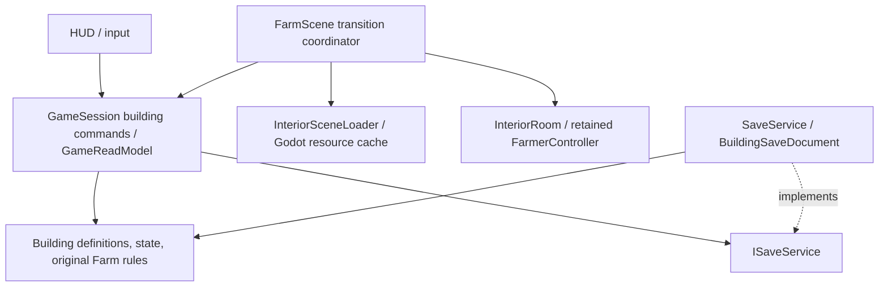

# Building and farmhouse interior slice

Branch: `feature/premium-game-systems`. Requested scope: implement building Milestones 1 and 2 first, verify and commit each. This is a tested single-player slice, **not completion of all six building milestones** or a production release.

## Verified audit

Only `docs/GDD_V1_1.md` of the named design documents was found. World Design v1.2, Farming & Economy v1.3 and Interior Design v1.2.1 were not present in the inspected repository. The user building prompt is archived separately as design input; it is not reported as a pre-existing implementation.

| Finding | Severity | Actual source / resolution |
| --- | --- | --- |
| Native walkability validates farm coordinates; storing room coordinates in Farmer would invalidate old invariants/saves. | High | `native/World.cs`, `Core/Domain/FarmInvariants.cs`. Preserve exterior coordinates; store validated interior location by stable player ID and project it through GameReadModel. |
| No zone navigation or interior scene existed. | High | `Scenes/Farm.tscn`, `Presentation/World/FarmScene.cs`. Keep live session/root; mount a validated interior scene and reparent the existing actor. |
| Independent chest and bag files could commit different revisions, duplicating/losing produce. | Critical for new storage | `Core/Infrastructure/Persistence/SaveService.cs`. Version 2 atomic envelope captures Farm v1 and buildings together through the existing bounded writer, backup and profile lease. |
| Async resource/transition continuations could outlive a freed scene. | High | `FarmScene.Persistence.cs`, `Diagnostics/FarmScene.Diagnostics.cs`. Reuse cancellable frame awaits; track and drain transition task on teardown. Test cancellation during restoration. |
| Outdoor rain/lighting and farm input would remain active indoors. | Medium | `WeatherLighting.cs`, `WeatherAccentPool.cs`, `FarmInputRouter.cs`. Hide exterior canvas items, suspend outdoor weather updates, validate actions by location, use interior lights and prompts. |
| A failed migration read could fault the writer without completing Flush. | High | `SaveService.WriteLoop`. Handle structural/JSON read failures as persistence failures; a five-second bounded fault test preserves exact live bytes and returns an error. |

Reusable foundation retained: original Farm action/time/price rules, GameSession, immutable read views, isolated profile/lease, bounded atomic save worker, paired import undo/backup recovery, shared fonts/theme/atlases/action voices, FarmerController, camera follower, cancellation and existing regression harnesses. No replacement engine or paid packages.

## Modules and dependencies



| Module | Responsibility |
| --- | --- |
| `Core/Domain/Buildings.cs` | Stable definition/region IDs, entrance/return/room markers, access/hours, room obstacles and structural state validation. Domain has no Godot APIs. |
| `GameSession.Buildings.cs` | Entry/exit/location, owner-thread command validation, conserved chest transfers, bounded UUID retry protection and light state. |
| `GameReadModel.cs` | Detached bag/chest views, projected position and current room/light read state. |
| `BuildingSaveDocument.cs` / `SaveService.cs` | Strict v1/v2 decoding, explicit migration, one snapshot/atomic replacement, backup/import recovery and error reporting. |
| `InteriorSceneLoader.cs` | Threaded resource polling, 10-second timeout and per-session packed-scene caching. Paths come from the registry, not save data. |
| `FarmScene.Buildings.cs` | Duplicate-transition gate, input freeze, door glow/sound/fade, validated scene mounting, actor reparenting, weather/camera switching and emergency return. |
| `InteriorRoom.cs` / `Farmhouse.tscn` | Original studio art, atlas foreground Y sorting, window/night light treatment, room tone and declared markers. |
| `FarmHud.Storage.cs` | Thai quantity input/deposit/withdraw UI; invokes application commands and never changes mutable inventory. |

No unused generic singleton, global event bus, per-building entrance controller or manager hierarchy was added.

## Playable controls and storage policy

Approach the farmhouse front door and press **F**. Inside, WASD/arrows use the retained movement speed/controller. Approach bed/chest/exit and press **F** (E also interacts indoors); Space near the bed uses the original sleep action. Sleep confirmation warns about original bag spoilage. Press Esc/settings and use the safe-return action if necessary. The farm hotbar/shop shortcut is suppressed indoors; bag, pause, save and settings remain usable.

The starter chest accepts the existing eight produce IDs, with a structural safety bound of 1,000,000 per stored stack. No new item/seed/crafting system or farm bag capacity restriction was introduced. **Produce in the chest retains its count across days; the original bag still loses 25% on new day.** This is an explicit new chest policy, communicated in UI and tested; its economic effect requires balance playtesting. Daily sale prices/growth/seasons were not altered. Sleeping delegates Farm's original energy/day/season/weather/bag rules after validating actual bed proximity; the player remains in the room on waking.

## Save compatibility and recovery

Before using buildings, the same complete Version 1 farm JSON is emitted. First building entry adds persistent room state and writes a **Version 2 Godot envelope**:

```json
{"Version":2,"Farm":{"Version":1,"...":"original fields"},"Buildings":{"Interiors":{},"Locations":{}}}
```

The example shows shape only, not a valid save fixture. Both version formats load; the nested Farm retains all original IDs/rules. Unknown/duplicate/missing fields and invalid player/room IDs, positions, levels or storage counts are refused. No assumed defaults erase unsupported future state. Level 1 is the implemented schema; future upgrades/furniture require explicit validated migration.

An existing v1 file is preserved byte-for-byte as `farm.json.v1-before-buildings` before the first extended replacement. If this is a new unsaved profile there is no original file to preserve. Current `farm.json.bak` backs up the **entire revision**, including bag/chest/positions/lights. Manual save, autosave, shutdown and import/recovery use the same atomic document and exclusive profile lease. There is no chest sidecar that can commit separately. Disk/migration failures keep the previous snapshot and are surfaced; abrupt power loss is not certified.

Older Native/Godot binaries do **not** understand the new envelope; do not open an upgraded Godot save with an old binary. Native's own separate profile and source remain unchanged. Existing v1 files import/load into the upgraded game; the preserved v1 copy enables deliberate rollback. Import replaces the complete farm/house state and preserves the previous paired farm/identity via the existing undo/backup mechanism. Tests never open real player profiles.

## Future multiplayer authority

The wire protocol in `native/Network.cs` remains unchanged. Buildings are single-player only in this slice. Future server commands: enter/exit (building ID), sleep (bed proximity), transfer (building/container ID, crop/item ID, quantity, direction, UUID), light change, later placement/upgrade. Server owns location, permissions/hours, collisions, source counts/capacity and shared chest/building state; client preview cannot authorize a transaction. Replicate region/building ID and local position per player, shared interior revision and individual bag changes. Retain the session when peers occupy different regions. Persist bag/chest together. Shared upgrades/furniture need ownership/access rules before shipping.

Current UUID cache is bounded to 512 commands per running session; it prevents immediate retry/signal duplication, not a durable replay ledger across restart. Future reconnect protocol must acknowledge/reconcile transaction revisions and retention policy. No claim of four rendered co-op players or cross-home building synchronization is made.

## Milestone reports

**Milestone 1 — `80b0761`:** new definitions/state, read-model location, transition/loader, room/art, save codec, camera/input and tests. Fixed exterior/indoor coordinate coupling, duplicate entry, resource failure recovery, weather isolation and unified persistence. Godot/Native builds: zero warnings/errors. Core 252, startup 60, recovery 10, gameplay 101, Premium 180, building scene 36, lifecycle 350 passed; no final failed checks. Source evidence `reports/building-m1-*.json`. Bed/storage were intentionally still pending at this verified checkpoint.

**Milestone 2:** conserved quantity transfers/UUID validation, original-rule bed sleep, light control, original door/room sound, indoor UI, restoration/teardown tests and migration fault handling. Final executed counts and performance are in `BUILDINGS_MEASUREMENTS.md`; genuine screenshots are `farmhouse-interior.png`, `farmhouse-storage.png`, `farmhouse-night.png`. No final failed checks after correction. Real human playtest remains open.

## Original assets

Built-in **image_gen** generated `Assets/Interiors/farmhouse-studio.png` (1536x1024). Full final prompt and tool mode: `Assets/Interiors/interior-prompts.json`. Displayed at 0.5 nearest scale, with shared atlas regions for occlusion; no reference-game artwork or Python image edits. Window lighting is an engine overlay. Original synthesized door/room WAVs are reproducible using `Tools/synthesize_interior_audio.py` and contain no third-party recordings. Existing typography/licenses/art were retained.

## Remaining scope / risks

Milestones 3-6 are **not complete**: movable furniture inventory/placement/rotation, floor/wall choices, levels 2/3 and upgrades, working shop interior, NPC homes/hours/conversations and final human visual/audio acceptance. Static studio furniture is functional bed/chest/decor, not a furniture-placement feature. No placeholder NPC or second interior is delivered. The registry supports access/hours but only one actual farmhouse definition is shipped. Window masks and collision landmarks are authored for this studio art; new rooms require their own verified definitions/markers. Long sessions, chest economic balance, broader accessibility, localization, full multiplayer and standalone export remain separate gates.
