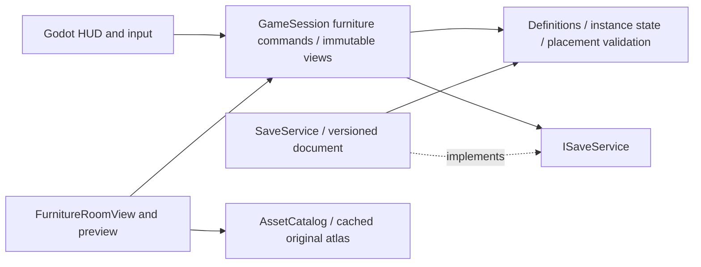

# Playable furniture — Seasons Together

Branch: `feature/premium-game-systems`. Engine audited: Godot 4.7.2 .NET / .NET 8.
This implements the first six-type indoor furniture loop; it does not replace the farming inventory.

## Playing

1. Open `godot/Run-Seasons-Together.cmd`. From the farm, enter the village via F near the sign on the right. Visit Rowan's workshop during his work schedule; press F near Rowan and choose **ซื้อเฟอร์นิเจอร์และไม้แปรรูป**.
2. Buy furniture or wood. Return to the farmhouse, press B, select the furniture's inventory card, then click a valid green preview. Red previews reject placement. Escape cancels without consuming anything.
3. R switches supported orientations: table horizontal/vertical; chair front/back. Moving preserves the current orientation until R changes it. Other pieces move without rotation.
4. Walk to the front of a placed object and press F. Storage: choose quantity, deposit, withdraw, organize. Tables/shelves: place one real inventory item per entry and retrieve it. Chair: choose sit; F stands. Workbench: choose a recipe, consuming real carried wood.
5. **ย้าย** opens a placement preview for the existing instance; its contents remain attached. **เก็บเข้ากระเป๋า** requires an empty piece and returns exactly one furniture item. Empty it first to protect stored/displayed items.

The original fixed bed still sleeps through the existing confirmation and farming rules. The fixed chest, lights, exits, NPC services and farm actions remain available.

## Content definitions

| Furniture ID | Interaction | Storage/display entries | Buy price | Wood recipe |
|---|---|---:|---:|---:|
| wooden-table | Display | 4 | 80 | 12 |
| wooden-chair | Sit | — | 35 | 6 |
| wooden-box | Storage | 12 | 50 | 8 |
| storage-chest | Storage | 24 | 100 | 16 |
| bookshelf | Display | 6 | 90 | 14 |
| crafting-workbench | Craft | — | 140 | 20 |

Wood costs 5 coins at Rowan. Recipes are immediate, with validated ingredients and output capacity; there are no pretend crafting jobs or timers. Prices apply only to these new items. A storage entry is an aggregate item ID/count, preserving existing inventory semantics. Each display entry is one item of a distinct ID. Containers accept produce, bought seeds, wood and stateless furniture items; tools/fixed furnishings are rejected. Produce storage caps at 1,000,000 per ID, seeds at 1,000,000, wood/furniture at 999. Carried furniture/materials cap at 999 per ID; placement caps at 64 objects. Existing produce backpack counts retain their original bound and overnight spoilage; deposited/displayed items stay protected, like the fixed chest.

## Audit before edits

| Severity | Actual source | Finding / decision |
|---|---|---|
| Critical compatibility risk | `Core/Infrastructure/Persistence/BuildingSaveDocument.cs`, `SaveJsonContract.cs` | Strict v1/v2 saves reject unknown data. Adding unversioned instance fields risks unreadable saves. Use an explicit v3 envelope and preserve a pre-migration file. |
| High capability gap | `Core/Domain/FurnitureDefinitions.cs`, `Buildings.cs` | Two fixed scene furnishings existed, with no placed identity, ownership, carry state, rotation or per-instance contents. Keep fixed metadata and add a separate instance model. |
| High compatibility risk | `native/World.cs`, `Core/Application/ItemTransactions.cs`, `GameReadModel.cs` | Legacy bags contain crop IDs only; seeds live in Village.Seeds. Never put furniture/seed-prefixed IDs into produce bags. Route all transfers to the correct existing source. |
| High collision risk | `Core/Domain/Buildings.cs`, `GameSession.Move` | Static obstacles alone cannot prevent new placed pieces blocking exits or trapping players. Validate furniture footprints, player positions and bounded room connectivity before mutation. |
| Medium presentation gap | `Presentation/Buildings/InteriorRoom.cs`, `World/FarmScene.Buildings.cs`, `UI/FarmHud.Inventory.cs` | Interiors draw painted props; F selects fixed services. Add scene-owned interactive sprites, contextual F routing and a real bag-to-preview loop. |
| Medium protocol boundary | `native/Network.cs`, `Core/Infrastructure/Network` | Legacy network snapshots cover Farm, not placed furniture. Preserve the wire protocol; do not imply that new furniture is synchronized online. |
| Low resource risk | `Infrastructure/Assets/AssetCatalog.cs` | New objects need consistently sized cached assets, rather than loading or resizing source art every frame. Bake an atlas offline and cache sprite/icon regions. |

No edits to `native/World.cs` or `native/Network.cs`; no new packages. Missing capabilities above were feature gaps, not claims that the existing fixed chest or farming rules were defective.

## Architecture / responsibilities

| Layer / files | Responsibility |
|---|---|
| Domain — `PlacedFurniture.cs`, `ItemDefinitions.cs`, `Buildings.cs` | Immutable six-type definitions, stable IDs, limits, serializable instances, ownership/content invariants, footprints and room reachability. No Godot dependency. |
| Application — `GameSession.Furniture.cs`, `GameSession.cs`, `GameSession.Buildings.cs`, `GameReadModel.cs`, `Services.cs` | Main-thread command coordination; price/ingredients/quantity/range/capacity/replay validation; original produce and seed inventory routing; detached read views; transient seating; save contract. |
| Persistence — `BuildingSaveDocument.cs`, `SaveService.cs` | Explicit v1/v2/v3 read/write rules, strict corruption handling, atomic replacement, preserved migration snapshot and existing backup/recovery worker. |
| Assets — `AssetCatalog.cs`, `FurnitureAssetBake.cs`, `FurnitureBakeRunner.cs`, `Tools/FurnitureBake.tscn` | Shared atlas, once-cached trimmed UI/item icons, explicit offline preparation. No resource loads in presentation/gameplay loops. |
| Presentation — `FurnitureRoomView.cs`, `FarmScene.Furniture.cs`, interior/input/player/context routing | Scene-owned Y-sorted sprites, contact shadows, real display item sprites, cached valid/invalid preview, supported orientations, seat presentation and teardown. |
| UI — `FarmHud.Furniture.cs`, bag/NPC integration | Actual Rowan offers, quantity transfers, display retrieval, organize, sit, recipes, move and empty pickup. Mutations go through Application only. |
| Verification — `FurnitureChecks.cs`, `FarmScene.FurnitureChecks.cs`, `Verify.ps1` | Isolated command/save regressions; real button/input/scene/restart tests; measured before/after workload. |

Before: fixed bed + fixed shared farmhouse storage. After: both remain intact, with independently identified, owned, movable instances sharing the same reusable renderer and command system. Inventory is still aggregate; this change is not a persisted slot/drag-and-drop inventory rewrite.

## Transactions / placement

Every durable furniture command requires a nonempty UUID. Successful UUIDs persist in a bounded 256-command ledger. Purchases require the real Rowan service and schedule; use/transfer/crafting/move/pickup require the owner's object in the current room within interaction range. Validation precedes inventory or coin changes; arithmetic uses long intermediates for capacity checks. Rejected operations leave both ends unchanged. Placement also rejects a live instance UUID even after that UUID ages out of the command ledger.

Placement snaps to half tiles, checks walls/static props/other objects/player positions, reserves the exit corridor and original bed/chest approach areas, and flood-fills a bounded half-tile grid from the spawn to protected interactions and players. Movement uses the same placed footprints. Moving is a command on the existing instance, not remove-then-recreate. Pickup rejects nonempty pieces. A seat leaves the saved standing position valid and blocks movement while seated; room changes clear the transient pose.

The scene owns all furniture nodes; no new session event subscribers are introduced. It rebuilds bounded sprites after a furniture revision, not every frame. Preview validation is cached until the snapped target, rotation, player position or revision changes. Definitions and atlas/icon regions are cached. Source artwork is never processed in gameplay. Runtime atlas: 400×192 RGBA, with explicit feet anchors and nearest filtering. Table 64px wide, chair 32px, shelf up to 72px tall; all use the existing player/camera scale. Original scene background and fixed furniture art remain intact; the open central floor is filled only by actual player furniture.

## Explicit save compatibility

- Existing v1 raw Farm and v2 building saves load without fabricated furniture. Profiles with no furniture keep their existing v1/v2 save encoding.
- First successful new-item purchase/crafting/placement state activates the v3 envelope with required furniture schema 1. The nested Farm remains version 1; crop IDs, prices, quality/yield, spoilage and seed keys remain unchanged.
- On the writer's first v3 replacement, the exact previous valid file is permanently retained as `farm.json.before-furniture-v3`. Existing `.v1-before-buildings`, `.bak`, atomic replacement, identity and recovery behavior remain in place.
- V2 documents containing nonnull furniture are rejected, as are v3 documents without furniture, unknown schemas, invalid IDs/owners/counts/placements and unknown JSON fields. Corruption never silently resets or drops objects.
- All tests create ignored GUID profiles under reports. No user saves are overwritten. Native's separate profile remains unchanged; the native executable is not a v3 reader. Keep Godot v3 saves paired with their unchanged `player.txt`.
- Future schema changes require a pure explicit migration, frozen original backup and full state validation before replacing the file. Footprint/catalog changes must account for previously placed layouts; unknown IDs are rejected rather than deleted.

## Executed validation

| Checkpoint | Changed files / fixed problems | Passed / failed final gate | Compatibility / remaining scope |
|---|---|---|---|
| Audit | Read catalogs, building/inventory state, save contracts, interior/input/asset loop; no edits yet | Core 383, Godot build / 0 | Original fixed furniture only; placed state missing |
| Domain / Application / Persistence | Core furniture state/commands/read model, save codec/worker, Core tests; ownership, conservation, capacity, collision and explicit migration | Core 470, build / 0 | Original farming/seed stores preserved; Native/protocol unchanged |
| Godot loop | Asset catalog/bake, furniture room, preview, HUD/NPC/bag/input/player/context routing, actual scene harness | First box 14, six types 60 / 0 | v3 restores actual nodes/items; wardrobes/co-op outside first six |
| Regression / measurement | verify.ps1, rendered assertions and raw frame/resource reports | All gates below / 0 | Finite target-machine soak; known ObjectDB exit warning remains |
| Delivery | Player guide, architecture/migration matrix, updated milestone status, screenshots and machine-readable summary | Evidence from actual final build/tests | Three commits separate backend, presentation and validation |

Before edits: Core **383** passed; Godot build passed with zero warnings/errors. After: Core **470** passed, including all original gameplay/save/legacy loopback-network regressions plus quantity/capacity/overflow, UUID replay, ownership/range, collision, empty pickup, item conservation, crafting, v2→v3 preservation, strict corrupt-save and restart cases. Builds remain zero-warning/error.

Real Godot farmhouse gates: first box loop **14** passed before exercising the other types; six-type gate **60** passed, including real Rowan buttons, bag cards, mouse preview/placement, F storage actions, organize, pickup, visible item deposit/retrieval, table rotation, chair sit/stand, chest deposit/withdraw, bookshelf material display, workbench recipes, exit rejection, Escape cancellation and actual new FarmScene creation from copied save/identity. The restarted scene restores all six visuals and releases its nodes on teardown.

Full rendered verification also covers Native build/self-test **35**, startup **60**, recovery UI **10**, smoke **101**, premium **180**, buildings **51**, NPC **34**, indoor layout **46**, backpack **21**, composition **190** and lifecycle **70**. Final results and measurements are in `reports`; see [validation record](FURNITURE_VALIDATION.md).

Issues found while implementing: a compile-time target-typed dictionary constructor was corrected; a movement fixture initially placed a box over the player and was corrected while preserving that rejection test; the initial restart fixture incorrectly used a public player ID instead of copying the private `player.txt` session token, and was replaced by an actual scene restart with the correct identity file. Final automated gates pass; these were not ignored failures.

## Remaining boundaries

The six pieces work in the local farmhouse and retain the existing fixed bed sleep action. Cabinets, wardrobes/outfit changes, new placeable beds, cooking/refrigerators, backpack stack splitting/drag-and-drop/upgrades and timed production queues are outside this first six-type catalog. Furniture co-op replication is not connected to the legacy protocol. No Internet validation or new standalone Windows export is claimed.

Seating reuses current directional character frames with a compact seated presentation; bespoke bent-knee sprites remain art polish. Rotation is supported in the two authored orientations for table/chair only. Stored displayed produce has the same aggregate metadata as the existing inventory; no invented quality/freshness fields.

Replay history is bounded to the latest 256 successful commands, not an unlimited distributed deduplication database. Persistence remains the existing asynchronous save worker: completed save/flush guarantees disk durability; a reported write failure requires retry/recovery. New invalid transactions are rejected before mutation. The known one-instance ObjectDB warning at diagnostic exit is still present from earlier NPC/composition runs; finite stable-node measurements do not certify lifetime leak freedom or a 64-object stress workload.
