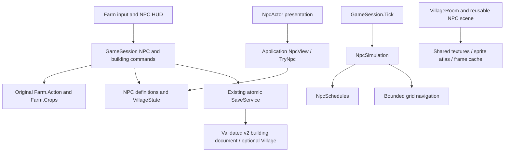

# NPC and living village — Milestones 1–2

Branch: `feature/premium-game-systems`. Baseline: `53865b1`. This delivery implements the NPC foundation and two playable characters. It does not complete the six-milestone roster/relationship/quest program.

## Audit and dependencies

Inspected actual `native/World.cs`, `native/Network.cs`, Core session/read models/persistence/network boundaries, world renderer, camera/input/HUD, building transitions and existing diagnostics. `docs/GDD_V1_1.md` exists. The named World Design v1.2, Farming & Economy v1.3 and Interior Design v1.2.1 were not found; their completion is not assumed.

The existing building slice was verified before introducing village presentation: Core 323 (including new foundation checks), zero-warning Godot build and 48 existing headless building checks passed. The reusable farmhouse entry/loader/save/camera exists. Movable furniture, house level upgrades and general NPC homes were not previously complete. There was no NPC simulation, village region, seed stock inventory or dialogue system.

| Severity | Finding / actual source | Resolution or remaining dependency |
| --- | --- | --- |
| Critical for new trades | `native/World.cs`: planting already charges the seed cost. A separate merchant debit could charge twice. | `GameSession.Npcs.cs` records prepaid seeds, uses the original crop cost, and invokes the original planting rule. Successful planting consumes one prepaid seed; failed planting restores coins and keeps the seed. |
| Critical for new saves | Separate NPC/trade sidecars would lose atomicity with farm coins. | `BuildingSaveDocument.cs` includes validated optional Village data in the same atomic farm/building document. |
| High | `GameSession.Buildings.cs`: entry/exit only supported farm-to-house. | Parent location definitions and nested entry/exit retain the native exterior anchor and return to the correct village door. Emergency return remains available. |
| High | Native walkability only describes the farm. | Village and room navigation use validated location coordinates; native Farmer coordinates remain on the original farm. |
| High | No simulation lifecycle exists for offscreen characters. | Pure Core schedules/navigation, persistent positions and transient cached routes; offscreen simulation resolves schedules without Godot nodes. |
| Medium | Long-running dialogues can outlast a working routine. | Commands recheck proximity, actual location and schedule when confirmed. Closing the menu always restores control; conversation-specific NPC holds remain a Milestone 3 improvement. |
| Medium / open | NPC diagnostics emit a RefCounted ObjectDB warning at process exit. | Node/observer teardown checks pass. Audio streams stop on scene exit, but the unidentified native exit reference needs further allocation/lifetime investigation. No leak-free certification is claimed. |

No packages were added. Native source and `dist` remain unchanged. The original crops, seasons, fertility, prices, spoilage, energy, day length and protocol remain the source of truth.

## Responsibility and dependency direction

| Module | Files | Responsibility |
| --- | --- | --- |
| Domain | `Core/Domain/Npcs.cs` | Stable definitions, strict persistent state, keyed Thai text, schedule resolution, bounded navigation and simulation; no Godot/graphics dependencies. |
| Locations | `Core/Domain/Buildings.cs` | Farm gateway, village, seed shop, workshop and two actual homes, collision, access hours and parent return points. |
| Application | `Core/Application/GameSession.Npcs.cs` | Immutable views, proximity/access, daily conversation guard, purchase/construction validation and recent successful command IDs. |
| Existing gameplay integration | `Core/Application/GameSession.cs`, `GameSession.Buildings.cs` | Original farm ticks/actions, prepaid planting, NPC simulation, parent location navigation, save requests and notifications. |
| Persistence | `Core/Infrastructure/Persistence/BuildingSaveDocument.cs` | Backward-compatible decoding and one atomic extended document. |
| Assets | `Infrastructure/Assets/NpcAssets.cs` | Cached NPC scene, texture atlas, directional frames and transparent-margin normalization through atlas metadata. No bitmap editing or per-frame loading. |
| Presentation | `Presentation/Village/NpcActor.cs`, `VillageRoom.cs` | Y-sorted sprites, facing/walk/idle presentation, Thai names, location visibility, background and indoor lighting. |
| Interaction | `Presentation/UI/FarmHud.Npcs.cs`, `FarmHud.cs`, `World/FarmScene.Buildings.cs` | Dialogue/choices/portraits, merchant quantities, carpenter service, seed bag information and existing transitions. |
| Verification | `Tests/NpcChecks.cs`, `Diagnostics/FarmScene.NpcChecks.cs`, `verify.ps1` | Isolated saves, simulation/economy regressions, actual UI/door routines, saved-scene restarts, frame samples and scene teardown. |

The village intentionally reuses the existing location container (`BuildingId`, type `village`) rather than replacing all world/session infrastructure. `InsideBuilding` currently means a non-farm location to legacy input/HUD consumers; type distinguishes outdoor weather from indoor roofs. Only the one village/parent level is shipped. General multi-zone streaming remains future work.

## Playable functionality

Walk to the new village sign on the right side of the farm near `(23, 8)` and press **F**. Walk with the existing controls. Press **F** near an NPC or a registered door. Bottom-centre exits return to the village or farm as appropriate. Settings retain emergency return to the farm.

**Mira:** original directional sprite/portrait, Thai greetings, farming guidance and contextual conversation, real seed-shop interaction, eight original crop types and quantities 1–99. Purchases use `Farm.Crops[crop].Cost`. Bought seeds persist and appear in the bag; planting uses them before cash. Seeds do not use the produce bag's overnight spoilage rule. Failure to plant does not consume a seed. Repeated successful purchase UUIDs cannot duplicate a transaction inside the bounded 128-command persisted history.

**Rowan:** original directional sprite/portrait, Thai carpenter guidance, actual workshop interaction and installation of the existing greenhouse. Price, insufficient funds, ownership and already-built checks remain in the original `Farm.Action("greenhouse")`; the player’s farm anchor is restored before saving. This is a functional building service, not a new house-level upgrade system.

Both characters physically leave interiors through their exits, walk across the village and enter registered buildings. Their routines are morning home before 08:00, work, fair-weather lunch 12:00–13:00, fair-weather square time after 17:00, and home after 19:00. Rain/storm keeps them working indoors instead of visiting the square. Homes allow player visits before 20:00 and always allow exit. Work services require the NPC physically present and scheduled to work, not merely an open doorway.

Visible travel uses cached collision-valid grid routes and bounded movement. Invisible NPCs in wholly unloaded locations can resolve directly to their current activity. Saved positions are validated and restored; paths are recomputed as needed. Day rollover still uses the original farm rule. NPC views read through the Application layer; renderers do not mutate simulation.

Minimal daily conversation friendship is persistent: 10 points once per NPC/player/day, capped at 1,000 (0–10 displayed hearts). Friendly greetings unlock at 100 points. History retains 20 valid text keys. This is the initial conversation baseline, not the complete relationship system. Text uses stable IDs and a locale catalog with Thai fallback. Gifts, special events, recipes and story unlocks are not implemented; no romance is shipped.

## Save and authority boundaries

- Original v1 saves and pre-NPC v2 building saves load. Legacy farmhouse saves may omit Village data. Saves that already use village interiors must retain both NPC states; a missing section or explicitly corrupt/null/unknown state is refused instead of silently resetting it.
- Even a metadata-only replay ledger requires the extended save envelope. Legacy-only persistence adapters refuse extended state instead of dropping NPCs, seeds or command history.
- NPCs, prepaid seeds, conversation state, recent successful trade IDs, coins and location are captured together by the existing bounded atomic save writer, backups and profile lease. Tests use GUID profiles, not real player saves.
- Existing original-v1 migration backup behavior remains. Older binaries that do not understand the extended document cannot be used to load current NPC state; retain backups when downgrading. This is forward-read compatibility in the new build, not reverse compatibility with old binaries.
- All commands validate on the owning Application thread. NPC scenes only read views. Current mode is single-player authority. `native/Network.cs` is unchanged and carries no new NPC RPCs.
- Future co-op must run one authoritative simulation on the host/server and project snapshots to clients. Authenticate player/session, validate region/proximity/schedule, dispatch commands to the coordinator and define reconnect/replay semantics. The bounded recent-UUID ledger is not an indefinite distributed exactly-once guarantee.

## Original assets and screenshots

Built-in **imagegen** created final `Assets/Village/village.png`, `npc-atlas.png` and `rooms-atlas.png`. Full prompts and mode are recorded in `Assets/Village/asset-prompts.json`. Generated character dimensions are read at runtime; alpha bounds and atlas margins align animation feet without modifying the original bitmap. The original farm/player assets were preserved. Existing theme/font/audio/sign assets are reused with their prior provenance.

Actual screenshots: `reports/village-square.png`, `mira-dialogue.png`, `mira-seed-shop.png`, `rowan-workshop.png`, `mira-home.png`, `rowan-home.png`. These are rendered game captures, not mockups. The price/shop screen scrolls to show purchase controls.

## Milestone status and remaining scope

The Core foundation was committed independently as `53edd77` after a zero-warning build, 323 Core checks and 48 existing building scene checks. Presentation/data refinements were then checked with the full rendered verification wrapper and targeted final Core/NPC runs; exact results, performance and known warning are in `NPC_MEASUREMENTS.md`.

Delivered: two real NPCs, village walking routines, conversation/choices/portraits, valid seed trade and greenhouse service, both workplaces and homes, persisted NPC state, readable Thai, day/weather behavior and real scene/regression tests. The other ten roster entries are definitions marked unimplemented, without fake sprites/services/schedules.

Not delivered: gifts, completed relationship stories/unlocks, reward-bearing crop requests, construction projects/house-level upgrades, furniture placement, festival/quest overrides, the other ten playable NPCs, general zone streaming, co-op NPC replication, long-session certification or standalone Windows export. Mira’s interest dialogue is guidance, not a completable quest. Rowan’s future house discussion does not pretend that upgrades exist.

Next recommended work is Milestone 3 (dialogue/relationships), beginning with the open native exit warning, conversation holds, gifts and daily limits, relationship content and broader Thai/text-scale acceptance. Milestone 4 can then generalize schedule policies/zone loading; milestone 6 owns actual reward-bearing quest content.
