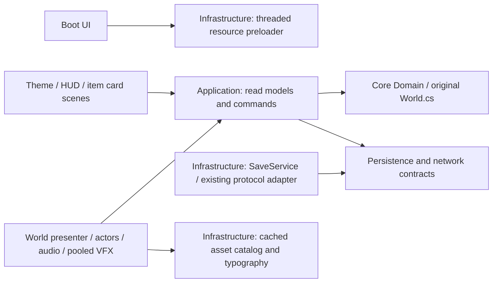

# Premium polish implementation and acceptance record

The playable Godot slice now uses bundled Thai typography, integer display scaling, original crop-growth/tool atlases, shared item cards, title/pause/loading UI, an optional day-one guide, action audio and bounded environmental effects. Gameplay rules remain in the original `native/World.cs` compiled by Core. This is a verified presentation upgrade, not a declaration that the entire farming RPG is commercially finished.

## Open and reproduce

Open `godot/Run-Seasons-Together.cmd` to play on the configured Windows machine; press **เข้าฟาร์ม** on the title screen. For development, import `godot/project.godot` in Godot 4.7.2 .NET, build, then F5. The launcher requires the installed engine and .NET SDK; it is not a standalone exported EXE. The Native release remains available separately.

From the repository root:

```powershell
.\godot\verify.ps1 -Rendered -ExtendedLifecycle
.\godot\verify.ps1
```

Use `-GodotPath <absolute-Mono-console-path>` when automatic discovery fails. Tests create GUID profiles in `godot/reports/` and never overwrite the real Native/Godot farm. Startup fault injection deliberately emits error logs; process exit, fresh report timestamps and check counts determine pass/fail.

## Source responsibilities and direction



| Module | Responsibility / actual use |
| --- | --- |
| `Infrastructure/Assets/FarmTypography.cs` | Validates bundled Thai fonts, caches the shared Theme and three text-size variants. |
| `Presentation/UI/FarmTheme.tres` | Warm cream/umber/sage styles; heading/body/compact/item heading hierarchy, focus/disabled/selected styles, tooltips and progress bars. |
| `Infrastructure/Assets/AssetCatalog.cs` | Cached textures, atlas regions, item scene, tool/character frames and action sounds. |
| `Infrastructure/Assets/FarmPreloader.cs`, `Presentation/UI/FarmBoot.cs` | Requests 21 actual resources on loader threads; frame polling, progress, timeout and error exit. Only retrieves completed requests. |
| `Presentation/UI/FarmHud.cs`, `FarmItemCard.cs`, `Scenes/UI/ItemCard.tscn` | Title, HUD, hotbar, inventory/shop cards, settings, confirmations, guide and pause navigation. Reads application state; sends original commands. |
| `Presentation/World/FarmScene.Display.cs`, `Core/Infrastructure/Configuration/DisplaySettings.cs` | Separate display preferences, window mode, UI/text size, reduced motion and effects volume; atomic writes independent of farm schema. |
| `FarmWorldPresenter.cs`, `FarmerController.cs` | Anchored four-stage crops, pixel-aligned movement, held-tool anticipation/recovery, cached idle/walk frames and unchanged hitboxes. |
| `WeatherLighting.cs`, `WeatherAccentPool.cs`, `EffectPool.cs` | Time/weather tint, windows, soft shadows, rain/ripples/splashes, seasonal accents, harvest/dust/water/coin feedback with bounded pools. |
| `Presentation/Audio/FarmAudio.cs`, `default_bus_layout.tres` | Eight reusable voices and five original short cues, controlled independently from external YouTube music. |
| `Diagnostics/FarmScene.Premium.cs`, existing diagnostics and `Tests/` | Font/display/input/card/audio/render/startup/save/protocol/lifecycle regressions. |

Domain/Application remain free of Godot/UI/Graphics APIs. No new farming-rule implementation or global event bus was introduced. Native multiplayer protocol and Save Version 1 are unchanged. YouTube still opens validated HTTPS YouTube links in the browser.

## Display contract

Design coordinates stay 800×450. World textures remain nearest-filtered; transforms, camera and animated foliage vertices snap to integer pixels. Dynamic UI fonts render at the integer canvas scale; HUD zoom 100/110/120% is independent of camera/input. Text sizes are body 14/16/18, heading 20/22/24 and item heading 16/18/20 logical pixels. Keyboard focus, modal Tab navigation and closing focus release are checked.

| Requested window | Integer world scale | Rendered content surface | Letterbox on each side / top |
| --- | --- | --- | --- |
| 1280×720 | 1 | 800×450 | 240 / 135 |
| 1920×1080 | 2 | 1600×900 | 160 / 90 |
| 2560×1440 | 3 | 2400×1350 | 80 / 45 |
| 3840×2160 | 4 | 3200×1800 | 320 / 180 |

The screenshots capture the content viewport, not OS decorations or black bars. A 4K window/surface was exercised on the current monitor; this is not physical 4K-monitor/DPI certification. Borderless keeps the chosen window size, avoiding Windows promotion of monitor-covering windows to exclusive fullscreen. No arbitrary fractional world zoom is used.

Reduced motion suppresses wind, water motion, rain and seasonal accent movement, dawn animation and held-tool gestures; essential notifications, plot information and state changes remain. Quality presets bound rain/accent/particle/light workloads. Title UI blocks input/time using presentation state without changing the saved pause flag. Pause/resume calls the original validated pause command. Menus do not introduce new purchases or costs.

## Art and audio provenance

New artwork was generated with the **imagegen** skill using the built-in `image_gen` tool, transparent-background generation mode, then packed with the Windows build-time `Tools/PolishBake` utility. No source pixels from the user's reference-game screenshots were copied. Exact prompt set and mode: `ArtSource/premium-prompts.json`.

- Original source sheets: `ArtSource/crop-growth-source.png`, `ArtSource/tool-icons-source.png` (excluded from Godot import/export by `.gdignore`).
- Runtime atlases: `Assets/crop-growth.png` (160×448, 32 cells of 40×56), `Assets/tool-icons.png` (96×48, eight 24×24 cells), `Assets/tool-poses.png` (128×224, seven four-pose tools); metadata `Assets/polish-regions.json`.
- Upper-left warm light, olive/sage foliage, honey/copper accents, umber outlines and consistent ground anchors. Four growth silhouettes per species are distinct; stages read original growth progress without changing growth rules.
- Original short action audio: `Assets/Audio/`, generated reproducibly by `Tools/synthesize_audio.py`; no sampled third-party music.
- Unmodified Mitr Medium and Sarabun Regular/SemiBold distributed with upstream OFL files and pinned hashes/URLs in `Assets/Fonts/provenance.json`; see `Assets/Fonts/ATTRIBUTION.md`.

Rebuild atlases/audio explicitly; no baking or synthesis occurs every frame:

```powershell
dotnet run --project godot/Tools/PolishBake -- godot/ArtSource/crop-growth-source.png godot/ArtSource/tool-icons-source.png godot/Assets
python godot/Tools/synthesize_audio.py
```

## Before / after evidence

Before: `reports/premium-before/{farm-day,farm-storm,shop}.png` and its `godot-smoke-Windows.json`. After: `reports/{farm-day,farm-storm,shop,title,pause}.png`, four `premium-<resolution>.png` and JSON reports. These are unedited Godot-renderer captures. Day/storm/shop use the same deterministic 24-ripe-crop fixture, camera and 1600×900 requested window. Before used an 800×450 viewport texture; after captures the 1600×900 canvas content. This intentional rendering change means raw screenshot pixel dimensions differ; it is not a matched-native-resolution GPU benchmark.

See `PREMIUM_MEASUREMENTS.md` for the measured quality table, completed check counts and finite-test limitations. No faster-rendering claim is made: the baseline lacks CPU/GPU measurements and after draws higher-resolution UI and additional effects. General smoke averages also include capture/resize/transition work; the controlled 600-frame quality samples are reported separately.

## Remaining acceptance work

- Artist review of existing full-body walk/arm frames, uniform pixel density on older scaled props, terrain/path/pond shoreline and further silhouette cleanup. New growth/tool assets are real runtime artwork; unused legacy `young-*` / `sprout` atlas regions are retained only for compatibility.
- Native Thai-reader review of complex tone-mark shaping, long localized descriptions and contrast; the automated glyph/bounds checks do not substitute for reading acceptance.
- Real-player keyboard/mouse tutorial usability and audible sound-mix review. Guide is a short dismissible overlay, not a new quest system; no controller-navigation claim.
- Long-session pacing/memory soak, physical 4K and Windows DPI testing. Finite scene cycles cannot prove absence of all leaks or stable 60 FPS across all possible gameplay.
- Godot Internet multiplayer integration, cross-house reconnection acceptance and standalone Windows export/package testing. Existing Native game remains intact, but those Native capabilities are not represented as already implemented Godot features.

No paid packages were introduced, user saves were not test fixtures, and Native/dist files were not replaced. See `PREMIUM_AUDIT.md` for prioritized findings and `PRODUCTION_PROGRESS.md` for the earlier modular-core work.
